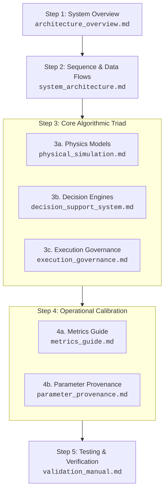

# 📖 Sentinel System Documentation Handbook

Welcome to the official technical documentation handbook for **Sentinel Command System** — a research-grade Decision Support System (DSS) and Execution Governance Layer (EGL) for autonomous disaster search-and-rescue.

---

## 🗺️ Recommended Reading Order

If you are new to the codebase or reviewing the system design for publication, follow this step-by-step reading order:



---

## 📚 Complete Document Catalog by Category

### Part I: Architecture & System Design (Start Here)
1. **[01. System Architecture Overview](file:///c:/Users/dorni/OneDrive/Desktop/project/docs/architecture_overview.md)**  
   *What it covers:* Decoupled FastAPI/Next.js architecture, project directory ledger, and SQLite data models (`sentinel.db`).  
   *Who should read:* Developers, system architects.

2. **[02. System Flows & Sequence Charts](file:///c:/Users/dorni/OneDrive/Desktop/project/docs/system_architecture.md)**  
   *What it covers:* Sequence interaction flowcharts, planning loop lifecycles, and EGL decision path state diagrams.  
   *Who should read:* Full-stack developers, integration engineers.

---

### Part II: Mathematical & Algorithmic Core
3. **[03. Physical Disaster Models](file:///c:/Users/dorni/OneDrive/Desktop/project/docs/physical_simulation.md)**  
   *What it covers:* BSSA14 seismic shaking (PGA), Holland B wind gusts, Rothermel fire boundary spread (ROS), and unified TWI depth-above-road flood accumulation.  
   *Who should read:* Disaster simulation researchers, physics engine developers.

4. **[04. Decision Support System (DSS)](file:///c:/Users/dorni/OneDrive/Desktop/project/docs/decision_support_system.md)**  
   *What it covers:* Bayesian telemetry updates, confidence age decay, multi-hazard risk Dijkstra, BPR congestion, and GEVA portfolio allocations with weighted demographic vulnerability.  
   *Who should read:* Operations research specialists, AI/optimization engineers.

5. **[05. Execution Governance Layer (EGL)](file:///c:/Users/dorni/OneDrive/Desktop/project/docs/execution_governance.md)**  
   *What it covers:* 5-dimension Decision Adequacy Protocol (DAP), asymmetric regret minimization ($R_{\text{act}}$ vs. $R_{\text{wait}}$), Mission Policy weights, Fleet Mutex, and Time-Boxed Human Overrides (TBHO).  
   *Who should read:* AI safety researchers, ethics/governance auditors.

---

### Part III: Operational Metrics & Parameter Provenance
6. **[06. Metrics & Telemetry Guide](file:///c:/Users/dorni/OneDrive/Desktop/project/docs/metrics_guide.md)**  
   *What it covers:* Mathematical formulations for survivor saved counts, fleet utilization, BPR multipliers, DAP adequacy indices, and geometric composite scores.  
   *Who should read:* Data analysts, frontend dashboard developers.

7. **[07. Parameter Provenance Specification](file:///c:/Users/dorni/OneDrive/Desktop/project/docs/parameter_provenance.md)**  
   *What it covers:* Scientific literature citation trail (FEMA, FAA, NFPA, Cowley 1971) justifying physical thresholds, vehicle clearance limits, and EGL decision parameters.  
   *Who should read:* Peer reviewers, domain experts.

---

### Part IV: Verification, Testing & Benchmarking
8. **[08. Systems Verification & Validation Manual](file:///c:/Users/dorni/OneDrive/Desktop/project/docs/validation_manual.md)**  
   *What it covers:* Pytest test specifications across core DSS, physics engines, EGL modules, immutability audit triggers, and TBHO countdown timers.  
   *Who should read:* QA engineers, test automation leads.

9. **[09. Validation & Latency Benchmarks](file:///c:/Users/dorni/OneDrive/Desktop/project/docs/validation_benchmarks.md)**  
   *What it covers:* Monte Carlo sensitivity analysis execution guidelines, parameter variance bounds ($\pm 30\%$), and execution latency logs.  
   *Who should read:* Benchmark evaluators.

10. **[10. Historical Disaster Validation Report](file:///c:/Users/dorni/OneDrive/Desktop/project/docs/historical_disaster_validation_report.md)**  
    *What it covers:* Benchmark evaluation reports across Mumbai Flood, Bhuj Earthquake, Nisarga Cyclone, and Aarey Wildfire presets.  
    *Who should read:* Publication authors, disaster response leads.

---

### Part V: Implementation Plans & Technical History
11. **[11. EGL Technical Implementation Plan](file:///c:/Users/dorni/OneDrive/Desktop/project/docs/egl_plan.md)** — Clean architecture design plan for EGL sub-modules.
12. **[12. DAP Enhanced Brainstorm Plan](file:///c:/Users/dorni/OneDrive/Desktop/project/docs/dap_enhanced_plan.md)** — Ethical trade-off analyses and real-world acceptability notes.
13. **[13. EGL Implementation Walkthrough](file:///c:/Users/dorni/OneDrive/Desktop/project/docs/egl_walkthrough.md)** — Historical verification breakdown and initial module release logs.
14. **[14. EGL Implementation Task Tracker](file:///c:/Users/dorni/OneDrive/Desktop/project/docs/egl_task.md)** — Module implementation checklist.

---

## 🎯 Role-Based Reading Pathways

* **🚀 Developer Quickstart:**  
  Read [01. Architecture Overview](file:///c:/Users/dorni/OneDrive/Desktop/project/docs/architecture_overview.md) → [02. System Flows](file:///c:/Users/dorni/OneDrive/Desktop/project/docs/system_architecture.md) → [08. Validation Manual](file:///c:/Users/dorni/OneDrive/Desktop/project/docs/validation_manual.md)

* **🔬 Academic / Paper Reviewer:**  
  Read [03. Physics Models](file:///c:/Users/dorni/OneDrive/Desktop/project/docs/physical_simulation.md) → [04. DSS Engine](file:///c:/Users/dorni/OneDrive/Desktop/project/docs/decision_support_system.md) → [05. EGL Governance](file:///c:/Users/dorni/OneDrive/Desktop/project/docs/execution_governance.md) → [07. Parameter Provenance](file:///c:/Users/dorni/OneDrive/Desktop/project/docs/parameter_provenance.md)

* **🛡️ Operations & Safety Auditor:**  
  Read [05. EGL Governance](file:///c:/Users/dorni/OneDrive/Desktop/project/docs/execution_governance.md) → [06. Metrics Guide](file:///c:/Users/dorni/OneDrive/Desktop/project/docs/metrics_guide.md) → [07. Parameter Provenance](file:///c:/Users/dorni/OneDrive/Desktop/project/docs/parameter_provenance.md)

---

## ⚡ Quick Execution Commands

```bash
# 1. Install Dependencies
pip install fastapi uvicorn sqlalchemy networkx numpy scipy pydantic pytest

# 2. Run All Verification Unit Tests (56 Passed)
python -m pytest

# 3. Launch Backend API Server (Port 8000)
python -m uvicorn backend.main:app --host 0.0.0.0 --port 8000 --reload

# 4. Launch Next.js Tactical Console (Port 3000)
cd frontend && npm run dev
```
