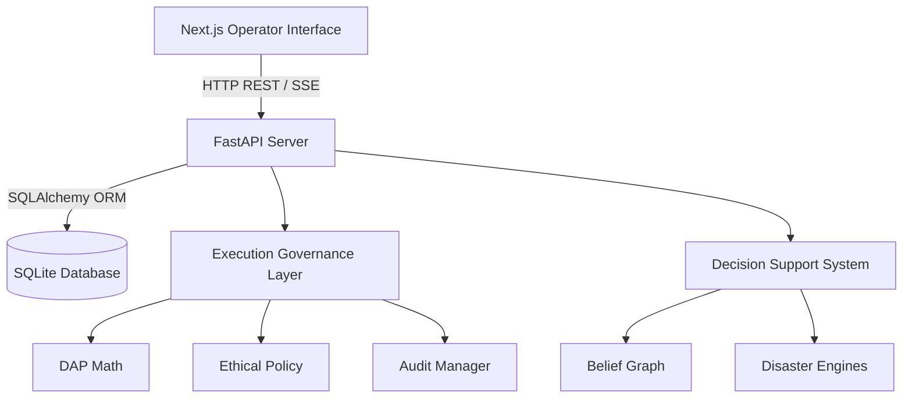

# System Architecture Overview

Sentinel utilizes a modern, decoupled client-server architecture designed to split high-intensity physics and decision-making calculations on the backend from high-framerate rendering updates on the frontend tactical interface.

---

## Architectural Topology



---

## Project Directory Ledger

```
├── backend/
│   ├── config_params/       # Central configuration parameters & egl_config.json
│   ├── world_model/         # Edge-State Tensors (DEST), world_state registry
│   ├── belief/              # Sensor models, Bayesian update, confidence decay
│   ├── disaster/            # Physical hazard propagation (BSSA14, Holland, Rothermel)
│   ├── routing/             # Normalised Dijkstra, multi-hazard risk projections
│   ├── allocation/          # GEVA portfolio matching and HVT detours
│   ├── execution_governance/# Execution Governance Layer (EGL) package
│   └── api/                 # REST controllers (FastAPI endpoints)
├── frontend/
│   ├── app/                 # Next.js app pages (EOC console layout)
│   └── components/          # Interactive map renderer, XAI dashboard panels
├── tests/                   # Python unit, integration, and sensitivity test suite
└── datasets/                # Cached OpenStreetMap XML datasets
```

---

## SQLite Database Schema

Sentinel synchronizes its belief and ground truth graphs with an on-disk SQLite database structure (`sentinel.db`). 

### Nodes Data Model
Tracks civilian population densities, telemetry observation timestamps, and current hazard danger scores.
*   `id` (PK, String): Unique node identifiers.
*   `node_type` (String): Category (`POPULATION_ZONE`, `SHELTER`, `HOSPITAL`, `NORMAL`).
*   `lat`, `lon` (Float): Geographical coordinates.
*   `population` (Int): Civilian occupants count.
*   `triage_immediate`, `triage_delayed`, `triage_minor` (Int): Injured categories.
*   `p_danger` (Float): Current hazard threat estimation $[0.0, 1.0]$.
*   `p_state_correct` (Float): Epistemic correctness probability of observations.
*   `status` (String): Physical status (`NORMAL`, `FLOODED`, `COMPROMISED`).
*   `last_observed` (DateTime): Timestamp of last direct observation.

### Edges Data Model
Stores connectivity networks, transit distances, road states, and geometries.
*   `id` (PK, String): Edge identifier.
*   `source` (FK, String): Source node ID.
*   `target` (FK, String): Target node ID.
*   `distance` (Float): Travel distance in meters.
*   `confidence` (Float): Traversal state confidence level.
*   `blocked` (Boolean): Current physical blockade status.
*   `speed_factor` (Float): Speed penalty multiplier ($[0.0, 1.0]$ due to water depth or debris).
*   `name` (String): OpenStreetMap highway name labels.
*   `geometry` (JSON String): List of intermediate GPS coordinates for map drawing.

### Mission State Data Model
Maintains session checkpoint snapshots.
*   `id` (PK, String): Session state key (`current_mission`).
*   `simulation_time` (Real): Simulation runtime ticker in minutes.
*   `total_survivors_saved` (Int): Cumulative rescues.
*   `agents_state` (JSON): Telemetry data arrays for all active vehicles.
