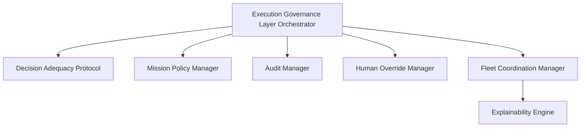

# Execution Governance Layer (EGL)

The **Execution Governance Layer (EGL)** is the orchestrating layer that wraps the Decision Support System (DSS). It governs whether tactical dispatches should execute, pause, defer, or escalate to human command, ensuring safe and accountable automation.

---

## 1. Modular Architecture & Responsibilities

The EGL separates responsibilities into six decoupled modules:

*   **DAP (`dap.py`)**: Computes the five adequacy dimensions and regrets. Free of logging or side effects.
*   **MPM (`mission_policy.py`)**: Manages policy weight profiles and enforces human authorization signatures.
*   **AM (`audit.py`)**: Decoupled audit manager delegating to an abstract append-only backend (referencing SQLite with DB-level locking triggers).
*   **HOM (`human_override.py`)**: Manages the Time-Boxed Human Override (TBHO) countdown protocol.
*   **FCM (`fleet_coordinator.py`)**: Coordinates fleet mutex locks, DEFER margin decay, and staged path calculations.
*   **XE (`explainability.py`)**: Translates EGL decisions into commander-readable plain English and technical summaries.

---

## 2. DAP Core Evaluation Math

The Decision Adequacy Protocol (DAP) evaluates five core dimensions and applies an asymmetric regret rule.

### A. Epistemic Readiness ($\epsilon$)
Measures the completeness and reliability of information for the target node and route. It is formulated as a convex combination of local node attributes (weighted at 60%) and route-level safety (weighted at 40%):

$$\epsilon = 0.60 \cdot \epsilon_{\text{node}} + 0.40 \cdot \epsilon_{\text{route}}$$

Where:
$$\epsilon_{\text{node}} = w_c \cdot \tau_{\text{avg}} \cdot \text{conf}(n) + w_a \cdot e^{-\lambda_a \cdot \text{age}(n)} + w_s \cdot \text{consistency}(n) + w_\delta \cdot \delta$$

Variables are defined as:
*   $w_c, w_a, w_s, w_\delta$ are normalized weights satisfying $w_c + w_a + w_s + w_\delta = 1.0$.
*   $\tau_{\text{avg}}$ is the sensor provenance trust multiplier, representing the average reliability factor of active sensors.
*   $\delta$ is the Source Diversity Index, calculated to discount redundant readings:
    $$\delta = 1.0 - \frac{\text{max\_count\_from\_any\_source}}{\text{total\_observations}}$$
*   $\epsilon_{\text{route}}$ represents the weakest-link edge confidence along the route: $\epsilon_{\text{route}} = \min_{e \in \text{route}} (\text{confidence}_e)$.

#### Derivation and Sensitivity Boundaries of $w_\delta$
The weights are calibrated based on information entropy limits. Direct confidence ($w_c = 0.35$), age ($w_a = 0.30$), and spatial consistency ($w_s = 0.20$) establish the baseline sensor channels. The diversity weight $w_\delta$ is bound to $0.15$. 

If $w_\delta$ is increased to $0.20$, the baseline channels are compressed to a combined weight of $0.80$. During initial search-and-rescue stages where only a single sensor type is active (e.g. UAV cameras, making $\delta = 0.0$), the maximum possible epistemic readiness is capped at:

$$\epsilon_{\text{max}} = 0.80$$

This artificial ceiling forces the decision rule to register a status of `DEFER` or `ESCALATE` for all candidate dispatches, inducing system starvation.

Conversely, if $w_\delta$ is set below $0.10$, the system fails to sufficiently discount redundant inputs, making it vulnerable to confirmation bias (e.g., treating three duplicate reports of an edge blockage from a single drone flight as three independent confirmatory observations). The value of $w_\delta = 0.15$ represents the analytical saddle point that penalizes correlated evidence without inducing resource starvation.

### B. Asymmetric Regret Decision Rule
Acting wrong carries different costs than waiting wrong. DAP computes competing regret values:

#### Regret of Acting ($R_{\text{act}}$)
The risk of executing dispatch under bad intelligence, unsafe conditions, or low resources:

$$R_{\text{act}} = \mu_{\text{act}} \cdot I \cdot \left[ (1 - \epsilon) \cdot C_{\text{info\_wrong}} + (1 - \sigma) \cdot C_{\text{crew\_lost}} + (1 - \rho) \cdot C_{\text{resource\_waste}} \right]$$

Where:
*   $I$ is the action's irreversibility coefficient (e.g. Evacuation $= 0.90$, Scout dispatch $= 0.20$).
*   $\sigma$ is the Crew Safety Index, and $\rho$ is Resource Sufficiency.
*   $C_{\text{crew\_lost}}$ is moral cost of casualties (Balanced $= 3.0$).

#### Regret of Waiting ($R_{\text{wait}}$)
The risk of deferring dispatch while survival probabilities decay:

$$R_{\text{wait}} = \mu_{\text{wait}} \cdot \text{AEM} \cdot \left[ \dot{D} \cdot \Delta t + P_{\text{closure}} \cdot C_{\text{route\_closure}} + e^{-0.01 \cdot t} \cdot C_{\text{golden\_hour}} \right]$$

Where:
*   $\dot{D}$ is the death rate of trapped survivors.
*   $\text{AEM}$ is the Access Equity Multiplier, boosting priority for isolated nodes.
*   $P_{\text{closure}}$ is the probability of route closure due to dynamic hazards.

#### Decision Rules
*   **EXECUTE**: $R_{\text{wait}} > R_{\text{act}} + m$ (or **STAGED\_EXECUTE** if $I \ge 0.80$).
*   **DEFER**: $R_{\text{act}} > R_{\text{wait}} + m$ (or safe default if doubts remain).
*   **ESCALATE**: $|R_{\text{act}} - R_{\text{wait}}| \le m$ and both exceed the crisis threshold $\theta_{\text{crisis}} = 2.0$.

---

## 3. Fleet Coordination & Anti-Starvation (FCM)

*   **Fleet Mutex**: Locks targets. If multiple vehicles attempt to target the same node, FCM blocks them with a `FLEET_MUTEX` veto, preventing redundancy.
*   **Anti-Starvation Decay**: Successive `DEFER` results on a target decay the decision margin ($m$) by $0.02$ per planning cycle:
    $$m_{\text{effective}} = \max\left(0.03, 0.15 - 0.02 \cdot N_{\text{defer}}\right)$$
    After $6$ consecutive defers ($N_{\text{defer}} \ge 6$), FCM triggers a forced escalation override. This override specifically targets lingering `DEFER` decisions to force human review, while allowing valid `EXECUTE` dispatches to proceed unhindered.
*   **Staged Dispatch**: Mass evacuation orders ($I \ge 0.80$) are truncated to a staging node located at the first $33\%$ of the route. The vehicle moves to the staging node and pauses while EGL gathers fresh data. Tactical rescue craft ($I = 0.55 - 0.75$) proceed directly.

---

## 4. Time-Boxed Human Override (TBHO)

When DAP returns `ESCALATE`, the system pauses autonomous dispatch and registers a TBHO request:

*   **Time-Boxed Countdowns**: The EOC console displays a countdown card:
    *   **Golden Hour**: $30\text{s}$ decision window.
    *   **Sustained Ops**: $60\text{s}$ decision window.
    *   **Recovery**: $90\text{s}$ decision window.
*   **Timeout Regret-Minimizing Defaults**: If no commander response is received before timeout:
    *   **Low Irreversibility ($I < 0.50$)**: Defaults to `EXECUTE` (scouts).
    *   **High Irreversibility ($I \ge 0.50$)**: Applies a **regret-minimizing fallback**: defaults to `EXECUTE` if $R_{\text{wait}} > R_{\text{act}}$ (minimizing lives lost when waiting risk exceeds acting risk), otherwise defaults to `DEFER`.

---

## 5. Provenance of Governance Parameters

All decision weights, cost parameters (`C_golden_hour`, `C_route_closure`, and AEM slopes), operational count margins, and time-boxed override limits are documented with their respective literature citations and mathematical boundaries in the [Parameter Provenance Guide](file:///c:/Users/dorni/OneDrive/Desktop/project/docs/parameter_provenance.md).

Note that while clinical trauma literature (e.g., Cowley 1971) and regional disaster statistics establish the mathematical basis and decay rate curves, the exact constant parameters (such as the specific regret cost coefficients) are treated as engineering parameters. These defaults are validated via Monte Carlo sensitivity sweeps to ensure decision stability.
