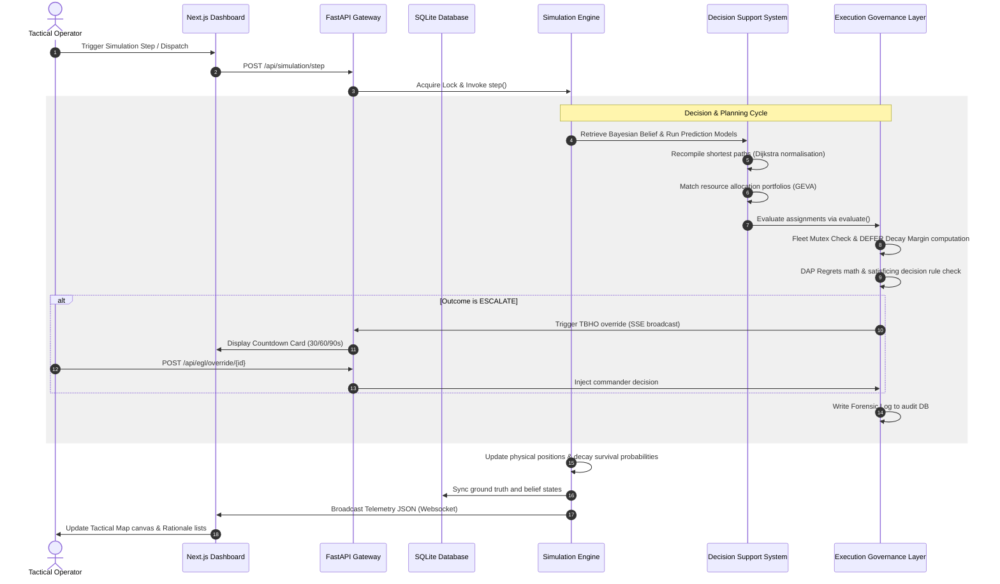
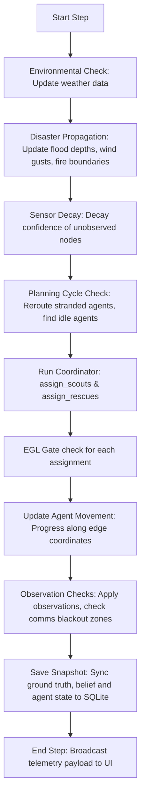
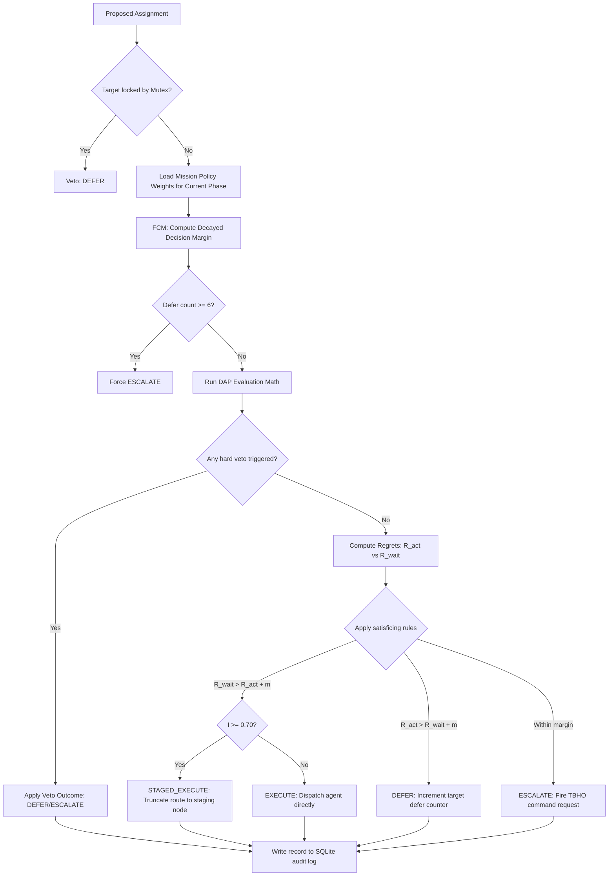

# System Architecture & Flow Guide

This document provides a Software Development Engineer (SDE) level specification of Sentinel's components, internal data flows, system cycles, and database relationships.

---

## 1. System Interaction Topology

The data pipeline operates as an asynchronous loop bridging a Next.js single-page application (SPA), an ASGI FastAPI web gateway, a persistent SQLite storage manager, a vector-graph matrix routing engine, and a modular Execution Governance Layer (EGL).



---

## 2. Core System Flows

### 2.1 The Simulation Step Loop
Each simulation step represents 1 minute of physical time. The step loop execution follows this sequence:



### 2.2 EGL Orchestrator Evaluation Loop
Every candidate dispatch proposal is evaluated by EGL before any route is assigned to an agent:



---

## 3. Database Relationship Diagram

The SQLite database (`sentinel.db`) is structured to optimize geospatial routing queries and ensure clean synchronization boundaries.

```
+--------------------+            +--------------------+            +--------------------+
|       nodes        | 1        N |       edges        | N        1 |    mission_state   |
+--------------------+------------+--------------------+------------+--------------------+
| id (VARCHAR, PK)   |            | id (VARCHAR, PK)   |            | id (VARCHAR, PK)   |
| node_type (VARCHAR)|            | source (VARCHAR,FK)|            | sim_time (REAL)    |
| lat (DOUBLE)       |            | target (VARCHAR,FK)|            | active_baseline    |
| lon (DOUBLE)       |            | distance (DOUBLE)  |            | total_rescues      |
| population (INT)   |            | confidence (DOUBLE)|            | agents_state (JSON)|
| triage_imm (INT)   |            | blocked (BOOLEAN)  |            +--------------------+
| triage_del (INT)   |            | speed_factor (DBL) |
| triage_min (INT)   |            | geometry (TEXT)    |
| p_danger (DOUBLE)  |            +--------------------+
| status (VARCHAR)   |
| last_obs (DATETIME)|
+--------------------+
```

### Forensic Audit Log (`egl_audit.db`)
Stored in a separate database file with restricted schema access and immutability triggers:
*   `record_id` (TEXT, PK): UUID4.
*   `timestamp_utc` (TEXT): ISO 8601 UTC timestamp.
*   `sim_time` (REAL): Simulation step timestamp.
*   `agent_id` (TEXT, FK): Dispatched agent.
*   `target_node` (TEXT): Ultimate target destination.
*   `outcome` (TEXT): Final action outcome (`EXECUTE`, `DEFER`, `STAGED_EXECUTE`, `ESCALATE`).
*   `epsilon`, `sigma`, `kappa`, `rho`, `delta`, `composite_score` (REAL): Adequacy variables.
*   `regret_act`, `regret_wait`, `effective_margin`, `irreversibility` (REAL): Regrets variables.
*   `authorized_by` (TEXT): Officer signature ID (required for overrides).
*   `human_override` (TEXT): Override outcome details.
*   `shadow` (INTEGER): $1$ if shadow run, $0$ if live.

---

## 4. Operational Parameter Reference

All operational thresholds, costs, and timeouts referenced in this architecture are cross-linked to their physical justifications and literature sources in the [Parameter Provenance Guide](file:///c:/Users/dorni/OneDrive/Desktop/project/docs/parameter_provenance.md).
